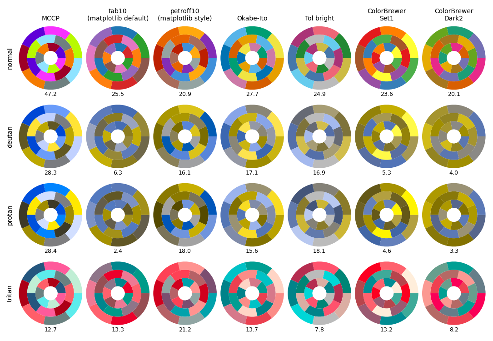
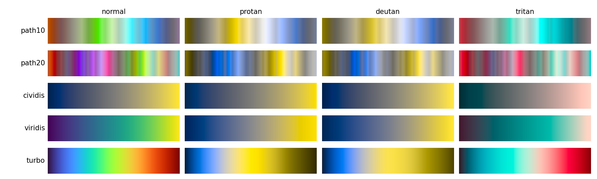
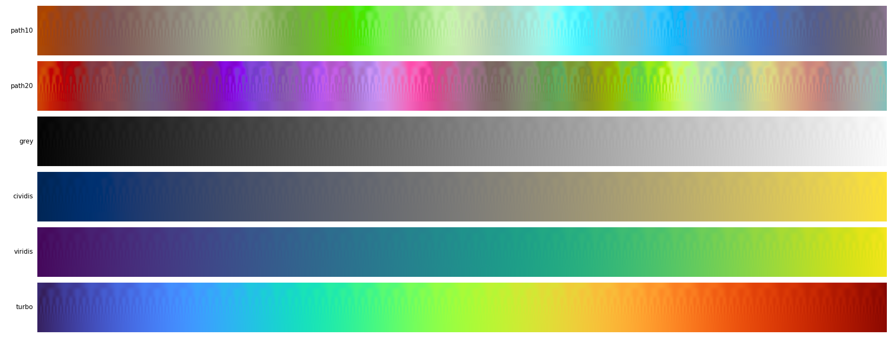
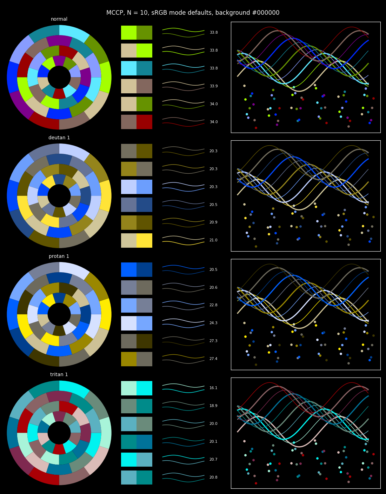

# cmapkit

cmapkit is a Python package for designing colour maps in CAM16-UCS, a colour
space in which equal distances look equally different. Version 0.1 contains
two methods. The first, MCCP (maximum contrast colour picking), chooses the
colours of a categorical plot. Given the number of data series N, it chooses N
colours so that the two least distinct colours are as distinct as its
optimiser can make them. The colours are chosen for that N and for the
background of the plot. They are also kept apart for readers with the common
deficiencies of colour vision, to a stated fraction of the separation that
normal vision receives. cmapkit works with matplotlib.

The first figure below compares a palette of seven colours from MCCP, on
white, with six common palettes, of which the longer ones give their first
seven colours. Each disc holds every colour of a palette once in each ring,
arranged so that every pair of colours meets at least twice
([docs/test-figures.md](docs/test-figures.md)). The rows show normal vision
and simulated deutan, protan and tritan vision. The number under each disc is
the least colour difference between two colours of the palette for that
observer, in the measure that MCCP maximises, so that the comparison favours
MCCP by construction; [docs/results.md](docs/results.md) compares the
palettes under other measures. MCCP's colours are the most distinct for
normal, deutan and protan vision. For tritan vision, to which it gives a
lower priority (Section 3), its least difference of 12.7 is close to those
of tab10 and Okabe–Ito and below the 21.2 of petroff10. The second figure
shows the default palettes for N from 3 to 30. `tools/palette_rings.py` draws
the first.




The second method, hdrmaps, is experimental. It gives long colour maps for
images of high dynamic range, such as electron micrographs, that are uniform
in contrast for normal and colour-deficient vision, with a length that can
be matched to the noise of the image. It is described in
[docs/hdrmaps.md](docs/hdrmaps.md). The first figure below shows the two
shipped maps, path10 and path20, beside three established maps, in normal
vision and in simulated protan, deutan and tritan vision.



The second figure, a variant of the test image of Kovesi (2015), shows how
plainly each map shows a small difference in the data. In each band the data
rise from left to right and carry a sine of constant amplitude, 0.01 of the
range, whose period is 64, 32, 16, 8, 4 and 2 pixels in six strips from the
top. In the lower half of each strip but the last, its sine fades out as that
of the next fades in, so that one strip passes into the next without an edge.
The colour difference by which a map shows the sine is proportional to its
speed there, the colour difference per unit of data, so a uniform map shows it
equally plainly across the band, and a long map shows it more plainly than a
short one. Turbo shows the sine most plainly at its blue end, where its speed
is about 400, and least in its green middle, where it is about 150 (in normal
vision); grey and cividis are nearly uniform, but at about 110 they show it
faintly throughout. In the strips of shortest period the eye averages the sine
away, as it averages the noise of an image, and sees the mean colour. The
bands are 2048 pixels wide, and the figure should be viewed at full size
(`tools/hdrmaps_figures.py` draws both figures).



The package is at the alpha stage (version 0.1.0.dev0), and its interface
may change.

## 1. Installation

```
pip install git+https://github.com/DavidLister/cmapkit
```

cmapkit requires numpy and scipy. The matplotlib helpers also require
matplotlib.

## 2. Use

```python
import cmapkit

pal = cmapkit.palette(8)                       # eight colours for a white background
pal.hex                                        # ['#...', ...]
pal.min_distance                               # least distance between two colours

cmapkit.palette(8, background="#000000")       # for a black background
cmapkit.palette(8, order="contrasting")        # neighbours as different as possible
```

With matplotlib:

```python
import matplotlib.pyplot as plt

cmapkit.use(8)                 # colour cycle for figures drawn from now on

fig, ax = plt.subplots()
for y in data:
    ax.plot(y, label=...)
ax.legend()
cmapkit.recolor(ax)            # recolour the series already drawn, and the legend
```

`use` takes the background from the current matplotlib style. `recolor`
takes it from the axes, and accepts a list of axes or a whole figure, so that
series on twin axes or several panels are coloured together.

With default settings, palettes with N from 1 to 50 on white, black and
#333333 (a common dark-grey plot background) are precomputed and are
returned at once. Other palettes are computed when asked for, which takes
from a few seconds at small N to one or two minutes at N = 50.

The functions above belong to MCCP and are also available as `cmapkit.mccp`,
for example `cmapkit.mccp.palette`. The colour space, observers and lightness
limits (`cmapkit.space`, `cmapkit.bounds`) are shared with hdrmaps.

For an image of high dynamic range:

```python
import matplotlib.pyplot as plt
import cmapkit.hdrmaps as hdr

rgb, details = hdr.render(image)     # 'path20', no blur
plt.imshow(rgb)

cmap = hdr.colormap("path10")        # a matplotlib colormap
plt.imshow(hdr.scale(image, "sqrt"), cmap=cmap)
```

`render` returns sRGB values in [0, 1], and in `details` the noise of the
image, the blur applied in pixels (none unless `blur` is given) and the length
of the map. A colour map from `colormap` is applied to the image after
`scale`, which clips it at the 0.1 and 99.9 percentiles and takes its square
root, as `render` does. Section 8 of [docs/hdrmaps.md](docs/hdrmaps.md) gives
the other functions, and `tools/compare_images.py` compares two maps on an
image.

## 3. Method

Fixed palettes such as matplotlib's tab10 have a set number of colours K. If
a plot has more series than K, colours repeat. If it has fewer, the first N
colours are used, and these are not the best set of N. MCCP computes a set
for each N.

Colour difference is measured in CAM16-UCS (Li et al. 2017). Lightness
differences are divided by K_L = 0.77, the lightness weight that Luo et
al. (2006) fitted to large colour differences. Without it, pairs differing
mainly in lightness looked more distinct, and pale pairs of equal lightness
less distinct, than the measure predicted, when test figures were inspected
by eye.

A colour is admitted only if it shows well against the background. How light
or dark a colour may be depends on its hue: yellows and greens can be light,
blues and violets dark. This follows the shape of the range of colours a
screen can show. These limits were judged by eye (Section 4).

About 8 % of men and 0.4 % of women of European descent have a red–green
deficiency of colour vision (Birch 2012). MCCP simulates the three kinds of
dichromat (Machado et al. 2009):

- deutans and protans, who lack the medium- or the long-wavelength cones;
- tritans, who lack the short-wavelength cones, which is rare.

Each simulated observer must see every pair of colours at least a stated
fraction of the separation required for normal vision: 0.6 for deutans and
protans, and 0.2 for tritans, because tritan deficiency is rare. Requiring
the full separation for every observer confines a palette to lightness and
blue–yellow differences. The fraction 0.6 keeps most of the separation for
normal vision.

MCCP maximises the least separation by numerical optimisation and then
spreads apart the colours that do not limit it. The colours are rounded to
8-bit values. The formulation and method are given in
[docs/design.md](docs/design.md).

## 4. Calibration

The lightness limits were judged by the author on an LG DualUp monitor in a
moderately lit room, on white, black and #333333 backgrounds. The monitor was
in a wide-gamut (DCI-P3) mode at the time, which showed colours somewhat more
saturated than a standard sRGB display does. On two sRGB monitors the charts
and palettes looked very similar; docs/calibration.md estimates the
effect. For other
backgrounds the limits are interpolated in the background's lightness, and
MCCP warns when this happens for a mid-tone background, where the
interpolation is least certain. `diagnostics["bounds"]` states which applies.
The procedure and the measured values are given in
[docs/calibration.md](docs/calibration.md),
with instructions for calibrating another background or display.



The figure shows a ten-colour palette on black, as seen with normal vision
(top row) and by the three simulated dichromats. In each row:

- left: a ring figure, in which every pair of colours touches twice
  ([docs/test-figures.md](docs/test-figures.md));
- centre: the six closest pairs, with their distances;
- right: a sample plot.

`cmapkit.mccp.figures.report_figure` draws it for any palette.

## 5. Results

At N = 10 on white, compared with matplotlib's tab10:

- the closest pair in the default MCCP palette is 1.6 times as far apart in
  MCCP's own measure, and 1.5 times in OKLab (Ottosson 2020), a colour space
  that neither palette was designed in;
- for a simulated deuteranope, it is 4.7 times as far apart;
- its least contrast ratio with white is lower: 1.3 against 2.0.

tab10 was designed for other qualities, such as moderate colourfulness, so
the comparison favours MCCP.

The default palettes give up some separation for normal vision in exchange
for separation for colour-deficient readers. For N from 3 to 30, normal
vision keeps 81 to 99 % of the separation it has when MCCP designs for
normal vision alone (`observers=[]`). The least separation for deutans and
protans stays at 0.6 of the normal-vision separation, against 0.02 to 0.44
for those normal-vision-only palettes.

The palette generators glasbey and Qualpal design for normal vision alone by
default. MCCP's defaults are ahead of them in MCCP's own measure at 12 to 14
of 14 values of N. Part of that lead is built in, since the measure's
lightness weight was chosen by the same eye that judged the palettes. In
OKLab, MCCP's defaults are ahead of Qualpal but behind glasbey. In the
measures that glasbey and Qualpal optimise, those programs lead. For
simulated deuteranopes, MCCP's least separation is four to eight times
larger (median over N), although Qualpal's default is ahead at 2 of 14
values. Against glasbey's colour-blind-safe mode, MCCP's defaults are ahead
in nearly every measure at every N from 3 to 12.

These figures are distances in models of colour difference. They have not
been tested in a study of readers.
[docs/results.md](docs/results.md)
gives the comparisons in full.

## 6. Options

| Argument | Meaning |
|---|---|
| `n` | Number of colours. |
| `background` | Background colour, as `'#rrggbb'`, a matplotlib name, or an RGB triple. Default white. |
| `text` | Colour of text and axes, kept clear of. Default black on light backgrounds, white on dark ones. |
| `order` | None (the default): no particular order. `'similar'`: neighbouring colours alike. `'contrasting'`: neighbours as different as possible. An integer G: groups of G colours, each well separated, for example to pair with line styles. |
| `observers` | Simulated observers, for example `[cmapkit.Observer("deutan", 1.0, 0.6)]`: type, severity from 0 to 1, and fraction of the normal-vision separation guaranteed. `[]` designs for normal vision alone. |
| `radii` | One number per colour. A colour with a larger radius is kept further from the others and from the background. |
| `fixed` | Colours already in use, which the new colours are kept apart from. |
| `anchors` | Further colours to keep clear of, each `cmapkit.Anchor(colour, clearance)`, added to the background and text anchors (clearances 20 and 15). `replace_anchors=True` replaces those. |
| `mode` | `'auto'` (the default, currently the same as `'srgb'`), `'srgb'`, or `'standard'`. The standard mode uses unweighted CAM16-UCS, one lightness limit for all hues, and normal vision only unless observers are given. |

Each palette carries `min_distance`, the least distance between two of its
colours for normal vision, and `diagnostics`, which include:

- the least distance for each observer;
- the scale achieved, which is the least distance divided by twice the
  observer's fraction;
- the pairs and conditions that limit it;
- the source of its lightness limits.

## 7. Limitations

- The lightness limits rest on one observer. They were measured on one display
  in a wide-gamut mode and checked on two sRGB monitors. Backgrounds other
  than white, black and #333333 use interpolated limits not checked by eye.
- No measure of colour difference has been validated for differences as
  large as those between palette colours.
- To keep colours distinct, MCCP admits colours of low luminance contrast
  with the background when they remain clearly visible, such as bright green
  on white. On white, the least contrast ratio is 1.25 to 1.37 at every N
  tested (tab10: 2.0 to 2.5). This is well below the 3 to 1 that the Web
  Content Accessibility Guidelines (W3C 2018) ask for graphical objects.
- The optimum found is local. Different starting points give results within
  about 1 % of one another.
- `recolor` handles lines and single-colour scatter plots. Error bars, bars,
  histograms, filled areas, box plots and colour-mapped scatter plots are
  refused.
- Palettes may differ slightly between platforms. They are reproducible for
  the same inputs, package version and platform.

## 8. Related work

Several programs maximise the least distance between colours for any N,
among them Qualpal (Larsson 2025), glasbey (McInnes) and maxdistcolor for
MATLAB. MCCP differs from them in three ways:

- its lightness-weighted CAM16-UCS measure;
- its lightness limits by hue for each background;
- its guarantees for simulated colour-deficient observers.

[docs/prior-work.md](docs/prior-work.md)
reviews earlier work.

## 9. Use of AI

The code, tests, benchmarks and documentation, including the review of the
literature, were written by an AI system (Claude, from Anthropic) under the
author's direction. The author set the aims, chose among the alternatives
proposed, supplied the papers, made every visual judgement (the calibration,
and the comparisons by eye reported in docs/results.md), reviewed the
results, and read the code before its release. Citations were checked
against the sources by the AI system where these were available; those not
confirmed are marked in docs/prior-work.md. The CAM16
implementation is tested against the colour-science package.

## References

- Birch, J. (2012). Worldwide prevalence of red-green color deficiency.
  Journal of the Optical Society of America A 29(3), 313–320.
- Kovesi, P. (2015). Good colour maps: how to design them. arXiv:1509.03700.
- Larsson, J. (2025). Qualpal: qualitative color palettes for everyone.
  Journal of Open Source Software 10(114), 8936.
- Li, C., Li, Z., Wang, Z., Xu, Y., Luo, M. R., Cui, G., Melgosa, M., Brill,
  M. H., and Pointer, M. (2017). Comprehensive color solutions: CAM16, CAT16,
  and CAM16-UCS. Color Research and Application 42(6), 703–718.
- Luo, M. R., Cui, G., and Li, C. (2006). Uniform colour spaces based on
  CIECAM02 colour appearance model. Color Research and Application 31(4),
  320–330.
- Machado, G. M., Oliveira, M. M., and Fernandes, L. A. F. (2009). A
  physiologically-based model for simulation of color vision deficiency.
  IEEE Transactions on Visualization and Computer Graphics 15(6), 1291–1298.
- Ottosson, B. (2020). A perceptual color space for image processing. Web
  article, https://bottosson.github.io/posts/oklab/.
- W3C (2018). Web Content Accessibility Guidelines (WCAG) 2.1.

## Licence

MIT. See [LICENSE](LICENSE).
[NOTICE](NOTICE) lists
third-party data included in the package.
