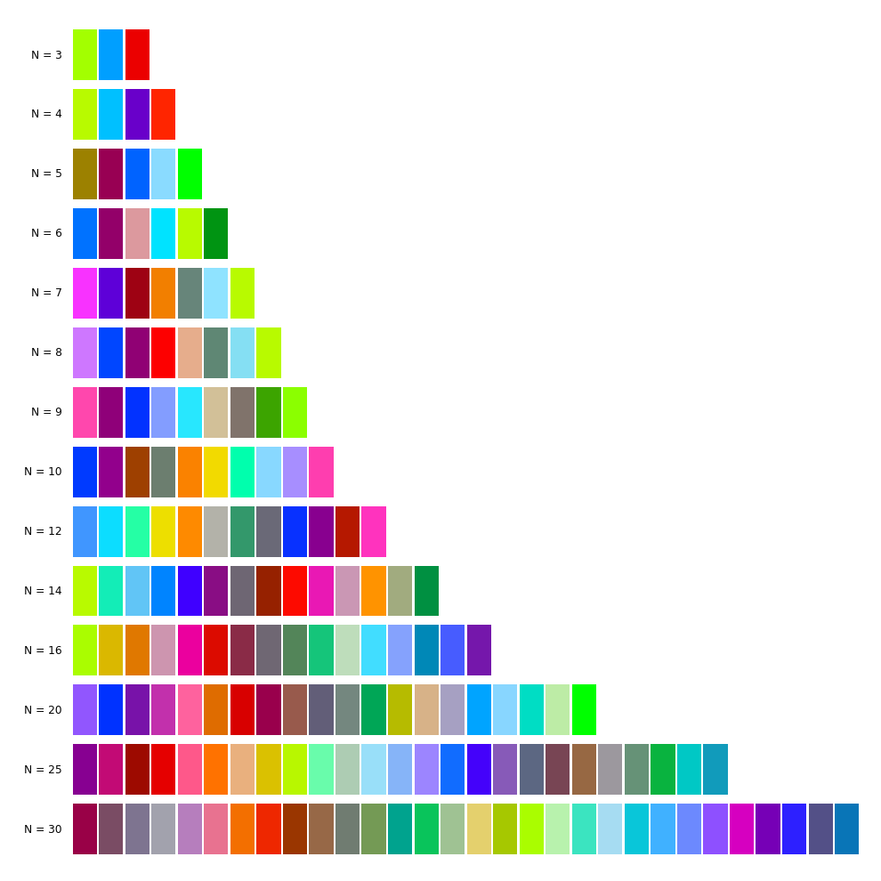

# MCCP: Maximum Contrast Colour Picking

MCCP chooses the colours of a categorical plot. Given the number of data
series N, it chooses N colours so that the two least distinct colours are as
distinct as possible. The colours are chosen for that N and for the
background of the plot. They are also kept apart for readers with the common
deficiencies of colour vision, to a stated fraction of the separation that
normal vision receives. MCCP works with matplotlib.

The package is at the alpha stage (version 0.1.0.dev0), and its interface
may change.



## 1. Installation

```
pip install git+https://github.com/DavidLister/MCCP
```

MCCP requires numpy and scipy. The matplotlib helpers also require
matplotlib.

## 2. Use

```python
import mccp

pal = mccp.palette(8)                          # eight colours for a white background
pal.hex                                        # ['#...', ...]
pal.diagnostics["scale_by_observer"]           # separation achieved, by observer

mccp.palette(8, background="#000000")          # for a black background
mccp.palette(8, order="contrasting")           # neighbours as different as possible
```

With matplotlib:

```python
import matplotlib.pyplot as plt

mccp.use(8)                    # colour cycle for figures drawn from now on

fig, ax = plt.subplots()
for y in data:
    ax.plot(y, label=...)
ax.legend()
mccp.recolor(ax)               # recolour the series already drawn, and the legend
```

Palettes with N from 1 to 50 on white, black and #333333 backgrounds are
precomputed and are returned at once. Other requests are computed when
asked for, which takes from a few seconds to about a minute.

## 3. Method

Fixed palettes such as matplotlib's tab10 have a set number of colours K. If
a plot has more series than K, colours repeat. If it has fewer, the first N
colours are used, and these are not the best set of N. MCCP computes a set
for each N.

Colour difference is measured in CAM16-UCS, a colour space designed so that
equal distances look equally different. Lightness differences are weighted
by 1/0.77, because in tests by eye pairs differing in lightness looked more
distinct, and pale pairs of equal lightness less distinct, than the
unweighted space predicts.

A colour is admitted only if it shows well against the background. How light
or dark a colour may be depends on its hue: yellows and greens can be light,
blues and violets dark, which follows the shape of the range of colours a
screen can show. These limits were judged by eye and are described in
Section 4.

Deficient colour vision is simulated for deutan, protan and tritan
observers (Machado et al. 2009). Each simulated observer must see every pair
of colours at least a stated fraction of the separation required for normal
vision: 0.6 for deutan and protan, 0.2 for tritan.

MCCP maximises the least separation by numerical optimisation, then spreads
apart the colours that do not limit it. The colours are rounded to 8-bit
values. [docs/design.md](docs/design.md) gives the formulation and method.

## 4. Calibration

The lightness limits were judged by one observer on an LG DualUp monitor in
a moderately lit room, on white, black and #333333 backgrounds. For other
backgrounds the limits are interpolated in the background's lightness. A
palette's diagnostics state which applies. The procedure and the measured
values are given in [docs/calibration.md](docs/calibration.md), with
instructions for calibrating another background or display.


## 5. Results

At N = 10 on white, compared with matplotlib's tab10:

- the closest pair in the default MCCP palette is 1.6 times as far apart in
  MCCP's own measure, and 1.5 times in OKLab, a measure neither was designed
  in;
- for a simulated deuteranope, it is 4.7 times as far apart;
- its least contrast ratio with white is lower: 1.3 against 2.0.

tab10 was designed for other qualities, so the comparison favours MCCP.

The default palettes give up some separation for normal vision in exchange
for separation for colour-deficient readers. For N from 3 to 30, normal
vision keeps 81 to 99 % of the separation it would have without the
simulated observers. The least separation for deutan and protan observers
stays at 0.6 of the normal-vision separation, against 0.02 to 0.44 for
palettes designed for normal vision alone.

The palette generators glasbey and Qualpal design for normal vision alone by
default. Against them, MCCP's defaults show the following:

- In MCCP's own measure they are ahead at most values of N.
- In OKLab they are ahead of Qualpal but behind glasbey.
- In the measures glasbey and Qualpal optimise, those programs lead.
- For simulated deuteranopes MCCP's separation is four to eight times
  larger (median over N).

Against glasbey's colour-blind-safe mode, MCCP's defaults are ahead in every
measure at nearly every N tested.

These figures are distances in models of colour difference. They have not
been tested in a study of readers. [docs/results.md](docs/results.md) gives
the comparisons in full.

## 6. Options

| Argument | Meaning |
|---|---|
| `n` | Number of colours. |
| `background` | Background colour, as `'#rrggbb'`, a matplotlib name, or an RGB triple. Default white. |
| `order` | `'similar'`: neighbouring colours alike; `'contrasting'`: neighbours as different as possible; an integer G: groups of G colours, each well separated, for example to pair with line styles. |
| `observers` | Simulated observers, for example `[mccp.Observer("deutan", 1.0, 0.6)]`: type, severity from 0 to 1, and priority (fraction of the normal-vision separation guaranteed). `[]` designs for normal vision alone. |
| `radii` | One number per colour; a colour with a larger radius is kept further from the others and from the background. |
| `fixed` | Colours already in use, which the new colours are kept apart from. |
| `anchors` | Other fixed colours to keep clear of, each with its own clearance. |
| `mode` | `'srgb'` (the default) or `'standard'`, which uses one lightness limit for all hues and normal vision only. |

Each palette carries `diagnostics`: the separation achieved for each
observer, the pairs and conditions that limit it, and the source of its
lightness limits.

## 7. Limitations

- The lightness limits rest on one observer and one display.
- No measure of colour difference has been validated for differences as
  large as those between palette colours.
- To keep colours distinct, MCCP accepts colours of low luminance contrast
  with the background when they remain clearly visible, such as bright green
  on white. The least contrast ratio can fall below the 3 to 1 that the Web
  Content Accessibility Guidelines ask for graphical objects.
- `recolor` handles lines and single-colour scatter plots. Error bars, bars,
  filled areas and colour-mapped scatter plots are refused.
- Results are reproducible for the same inputs, package version and
  platform.

## 8. Related work

Several programs maximise the least distance between colours for any N,
among them Qualpal (Larsson 2025), glasbey (McInnes) and maxdistcolor for
MATLAB. MCCP differs in its lightness-weighted CAM16-UCS measure, its
hue-dependent lightness limits for each background, its guarantees for
simulated colour-deficient observers, and its continuous optimisation.
[docs/prior-work.md](docs/prior-work.md) reviews earlier work.

## 9. Use of AI

The code, documentation and reviews of the literature in this project were
produced by an AI system (Claude, from Anthropic). The author directed the
work, setting its aims, making the design decisions, selecting the sources,
judging the colours by eye for the calibration, and reviewing the results.
Statements of fact have been checked against the sources cited where these
were available.

## References

- Larsson, J. (2025). Qualpal: qualitative color palettes for everyone.
  Journal of Open Source Software 10(114), 8936.
- Li, C., Li, Z., Wang, Z., Xu, Y., Luo, M. R., Cui, G., Melgosa, M., Brill,
  M. H., and Pointer, M. (2017). Comprehensive color solutions: CAM16, CAT16,
  and CAM16-UCS. Color Research and Application 42(6), 703–718.
- Machado, G. M., Oliveira, M. M., and Fernandes, L. A. F. (2009). A
  physiologically-based model for simulation of color vision deficiency.
  IEEE Transactions on Visualization and Computer Graphics 15(6), 1291–1298.

Further references are given in the documents under [docs/](docs/).

## Licence

MIT. See [LICENSE](LICENSE). [NOTICE](NOTICE) lists third-party data
included in the package.
