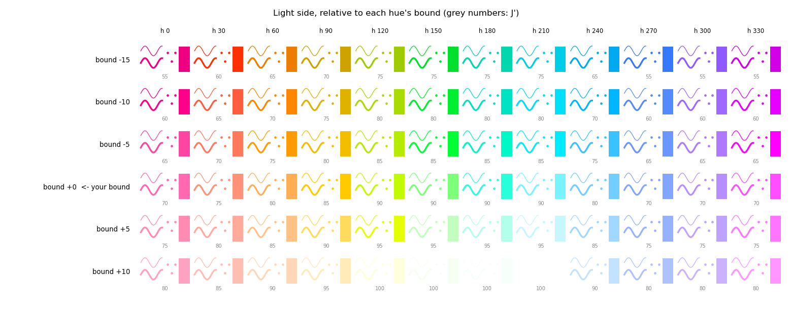

# Calibration of the lightness limits

The admissible colours of MCCP's default mode depend on lightness limits that
vary with hue and background ([design.md](design.md), Section 3). This note
records how they were measured and gives the values.

## 1. Conditions

The limits were judged on 2026-11-22 by the author, who has normal colour
vision, on an LG DualUp monitor in a moderately lit room. They are judgements
of what remains satisfactory in a plot, not thresholds of detection. They
apply only approximately to other displays and rooms.

The monitor was in its DCI-P3 picture mode, without colour management, so
sRGB colour values were shown with the monitor's wider primaries. Taking the
mode to use Display P3 primaries with the sRGB tone curve, the colours at the
measured limits were shown up to about 2 units of J' lighter or darker than
the model assumes, and 2 to 18 % more colourful; the largest increases were
for oranges, yellows and greens. The lightness shifts are smaller than the
steps of 5 units between rows of the charts. The limits are therefore
expected to hold for sRGB displays to within the resolution of the charts,
but the colours were judged as bolder than they appear on an sRGB display.
The author later viewed the charts and palettes on two older sRGB monitors
(ASUS PB278Q), where they looked very similar, and the limits were kept.

## 2. Procedure

Each chart shows rows of colours at a series of lightness values J'. Within a
row, twelve columns span the CAM16 hue circle at 30° intervals. Each colour
is drawn as a thin line, a thick line, small markers and a patch. Each
lightness appears twice: at the strongest colourfulness sRGB allows at that
lightness and hue ("full"), and at half of it ("half"). The judgements used
the full rows. The charts are made by `mccp.calibrate.lightness_page`.



For each background, the observer judged two charts:

- On the background side, the lightest (on white) or darkest (on black and
  #333333) row in which every colour of a column was still clearly visible.
- On the text side, the darkest (on white) or lightest (on dark backgrounds)
  row in which the colours still read as colours and not as the text colour.

The white background was judged twice. On the first charts the dark side did
not reach far enough to find the limit for several hues. The second pass used
charts with rows placed relative to the first estimates
(`mccp.calibrate.bounds_page`, shown above for the light side) and found
those limits.

## 3. Values

CAM16 hue h in degrees; lightness J' in the viewing conditions of each
background. On white, "highest" is the limit on the background side and
"lowest" on the text side; on black and #333333 it is the other way
round.

| h | 0 | 30 | 60 | 90 | 120 | 150 | 180 | 210 | 240 | 270 | 300 | 330 |
|---|---|---|---|---|---|---|---|---|---|---|---|---|
| White, lowest | 35 | 35 | 50 | 55 | 55 | 50 | 55 | 55 | 50 | 40 | 35 | 35 |
| White, highest | 70 | 75 | 80 | 85 | 90 | 90 | 90 | 90 | 80 | 70 | 70 | 70 |
| Black, lowest | 50 | 50 | 55 | 65 | 65 | 60 | 65 | 65 | 60 | 55 | 50 | 50 |
| Black, highest | 85 | 80 | 85 | 90 | 95 | 95 | 95 | 95 | 85 | 80 | 80 | 85 |
| #333333, lowest | 45 | 45 | 55 | 65 | 65 | 55 | 60 | 60 | 55 | 50 | 50 | 45 |
| #333333, highest | 85 | 85 | 85 | 90 | 95 | 95 | 95 | 95 | 85 | 80 | 80 | 85 |

The lightness of the backgrounds themselves is 100 (white), 24.3 (black) and
39.4 (#333333). Black lies well above zero because of the 1 % flare and the
adaptation to a dark background.

The limits follow the shape of the sRGB gamut. The lightness at which each
hue reaches its greatest colourfulness ranges from about 44 (blue) to about
92 (yellow), and hues that are colourful at high lightness tolerate light
values.

## 4. From measurements to limits

The measurements yield three quantities by hue:

- the floor, below which colours read as black: the lowest values on white;
- the ceiling, above which colours read as white: the highest values on black
  and #333333;
- the margin, the least lightness difference from the background: on white,
  100 minus the highest value; on black and #333333, the lowest value minus
  the lightness of the background.

Condition (2) of [design.md](design.md) combines them. On each calibrated
background it reproduces the measured limits exactly. On any other background
the margin is interpolated linearly in the background's CIE L* (0 for black,
21.2 for #333333, 100 for white). The ceiling is interpolated between black
and #333333 and held constant beyond. The floor is taken from white.

For backgrounds between #333333 and white, the interpolation spans a wide
gap and is the least certain. On such a background colours must keep clear
of the background on both sides. The present charts measure only one limit
on each side, so a mid-grey calibration will need charts that find both edges
of the band.

## 5. Calibrating another display or background

```python
from mccp.calibrate import lightness_page

lightness_page("high", background="#ffffff", text="#000000", path="light.png")
lightness_page("low", background="#ffffff", text="#000000", path="dark.png")
```

Judge each chart as in Section 2, one row per column, using the full rows.
The values form a `mccp.bounds.HueBounds` table. There is at present no
argument for supplying a calibration: adding one means editing `SRGB_BOUNDS`
and `bounds_for` in `mccp/bounds.py`, which combines the tables for white,
black and #333333 only.
