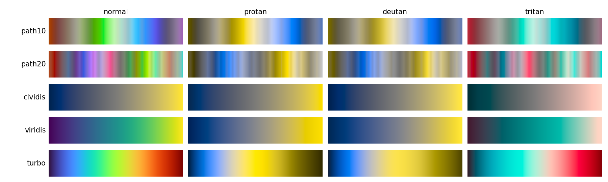

# Colour maps for images of high dynamic range

This note describes the subpackage `cmapkit.hdrmaps`: what its colour maps
are for, how they are made, how they compare with established maps, and
their limits. Section 8 shows how to use them.



## 1. Purpose

Some images hold detail at many levels of the signal at once. A scanning
electron micrograph, for example, may show a bright flake on a dark
substrate, with faint contrast inside the flake and inside the substrate.
Shown through a grey map, or through a monotone map such as viridis, the
detail at each level gets only the small part of the map's colour range
that falls at that level.

A colour map is a curve through a colour space, traversed as the data run
from their least to their greatest value. Its length L, the sum of the
colour differences along it, measured here in CAM16-UCS (Li et al. 2017),
is the total contrast it can give the data; Bujack et al. (2018) call it
the map's discriminative power. A monotone map is short: grey is 107 long,
viridis 132 (Section 6). A map can be made longer only by letting it wind
through the colour space, giving up the steady rise of lightness that makes
a monotone map easy to read.

The maps of this subpackage are long, winding maps with three properties:

- uniform: equal steps in the data give equal colour differences, for
  observers of normal vision and for simulated protan, deutan and tritan
  observers;
- separated: parts of the map far apart in the data stay distinct in
  colour, for every one of these observers;
- matched to the noise: the image is blurred just enough that the map
  shows its noise at a chosen level (Sections 3 and 4).

## 2. An earlier approach

The first maps tried repeated the lightness several times over the range,
with a steady turn of hue to tell the cycles apart (`OscillatingMap`). A
rounded sawtooth of four cycles is 684 long, but its curve turns back on
itself by up to 159° at each peak, so that the map reverses over a few
steps there. Its separation is 0.1 for protan and 0.2 for deutan
observers: to them, values a cycle apart look the same. These maps are kept
in the module `maps` for comparison only.

## 3. Scaling and noise

Let the raw image be scaled to t in [0, 1] by its square root, after
clipping at the 0.1 and 99.9 percentiles. For shot noise, whose variance is
proportional to the signal, the square root makes the noise equal at every
level. Let σ(s) be the standard deviation of the noise in t after a
Gaussian blur of s pixels. The range of the data in units of the noise is

$$D(s) = 1 / \sigma(s). \tag{1}$$

σ(0) is estimated from the image by the method of Immerkær (1996): the image
is filtered with the 3 × 3 mask that is the outer product of (1, −2, 1) with
itself, which removes planes and nearly removes smooth signal, and the
median absolute response gives the noise with little influence from edges.
For white noise σ(s) = σ(0) ‖k_s‖, where ‖k_s‖ is the root sum of squares of
the blur kernel.

## 4. Length of a map

A map of length L traversed at uniform speed shows a change dt in the data
as a colour difference L dt, and so shows the noise as a colour fluctuation
of standard deviation L σ(s). We ask that this equal a threshold T, in
colour difference per noise standard deviation. The length an image
supports is then

$$L = T\,D(s), \tag{2}$$

and L / T is the number of noise steps the map shows across the range. Below
T the map wastes detail present in the data; above it the grain of the
noise is plainly visible. T = 3 is used throughout. It is a provisional
value and has not been measured (Section 7).

Equation (2) is read in either direction. For an image and a blur it gives
the length; for a map of given length it gives the blur. For an image with
σ(0) = 0.025 (D(0) = 40), viridis needs a blur of 0.37 pixels, path10 0.72
and path20 1.29. For a noisier image with σ(0) = 0.07 the blurs are 0.87,
2.0 and 3.6 pixels. A long map therefore trades resolution for contrast: it
suits an image whose detail is larger than the blur it needs.

## 5. Construction

Each shipped map is made in four stages by `tools/make_hdrmaps.py`.

1. Palette. MCCP chooses N colours (N = 10 or 20) with its closest pair as
   distinct as it can make them, in image mode: within the lightness floor
   and ceiling by hue calibrated for MCCP ([calibration.md](calibration.md)),
   carried over to a mid-grey surround, with protan and deutan observers
   guaranteed 0.6 of the separation and tritan 0.2.
2. Order. The colours are put in the order of a short open path (nearest
   neighbour from several starts, then 2-opt), from the darker end.
3. Curve. The polyline through the colours is resampled to M points at
   equal steps of colour difference (M = 40 or 70).
4. Optimisation. The points are moved to satisfy the conditions below,
   then the map is the polyline through them, sampled at 4096 equal steps.

Distances are measured in CAM16-UCS with a lightness weight of 0.77, as in
MCCP's calibrated modes, under viewing conditions of a mid-grey surround
(`paths.PATH_VIEW`). Each colour-deficient observer o is simulated by the
method of Machado et al. (2009) at full severity, and given a priority p_o.
Let u_i be the coordinates of point i in normal vision, u_i^o those for
observer o, and a_ij the length of the polyline between points i and j. The
conditions are

$$|u_{i+1} - u_i| = \ell, \tag{3}$$

$$|u_i^o - u_j^o| \ge p_o\,\rho\,\sin(\min(a_{ij}/\rho,\ \pi/2)) \quad (|i - j| \ge 2), \tag{4}$$

$$(1 - b)\,\ell_o \le |u_{i+1}^o - u_i^o| \le (1 + b)\,\ell_o, \qquad \ell_o \ge q_o\,\ell, \tag{5}$$

together with the lightness floor and ceiling and the sRGB cube. Equation
(3) makes the map uniform in normal vision. The right side of (4) is the
chord of a circle of diameter ρ spanning the arc a_ij, up to a quarter turn,
and ρ beyond: parts of the curve far apart along it stay ρ apart, and
nearby parts may approach no closer than on that circle, so that the curve
cannot turn more sharply. This is a discrete form of the thickness of a
curve (Gonzalez and Maddocks 1999). Equation (5) holds each colour-deficient
observer's steps within the fraction b of a step ℓ_o of its own, so that its
speed varies by no more than (1 + b)/(1 − b), and at least q_o times the
normal step. Equal steps for every observer at once cannot be had in
general: a direction has two degrees of freedom, and fixed ratios of speed
for three other observers are three conditions on it.

The conditions are met by sequential linear programming in a trust region,
each linear programme being allowed to violate them at a penalty. With ℓ
fixed the thickness ρ is maximised; with ρ fixed the step ℓ, and so the
length, is maximised. path10 is made with ℓ fixed, path20 with ρ = 8.

For protan and deutan observers the simulated colours lie nearly on a
surface, spanned by lightness and a blue to yellow axis, so that in their
view the map is a curve in a plane. A curve in a plane cannot pass through
itself without its thickness first falling to zero, so the optimiser cannot
undo a crossing in their view that is present in the start. For path20 the
palette is therefore ordered by the larger of the protan and deutan
distances, rather than by the normal ones: a path that is short in a plane
does not cross itself. In path20 the tritan priority in (4) is raised to
0.4, since 0.2 at ρ = 8 would guarantee a separation of only 1.6.

## 6. Results

The measures (`cmapkit.hdrmaps.assess`) are the length L; the speed, in
colour difference per unit of data averaged over windows of 1/64 of the
range, given by its ratios p95/p5 and max/min; and the separation, the
least colour difference between parts of the map at least 10 % of the range
apart. A perfectly uniform map has speed ratios of 1.

| Map | L normal | L protan | L deutan | L tritan | worst p95/p5 | worst max/min | least separation |
|---|---|---|---|---|---|---|---|
| grey | 107 | 107 | 107 | 107 | 1.66 | 1.90 | 8.4 |
| cividis | 106 | 103 | 108 | 98 | 1.39 | 1.94 | 8.3 |
| viridis | 132 | 110 | 108 | 130 | 2.71 | 3.65 | 5.5 |
| batlow | 138 | 124 | 128 | 118 | 2.51 | 3.12 | 7.2 |
| CET-L20 | 164 | 141 | 139 | 134 | 4.53 | 8.15 | 6.4 |
| turbo | 251 | 225 | 202 | 228 | 12.14 | 25.30 | 2.3 |
| rounded sawtooth, 4 cycles | 684 | 672 | 663 | 677 | 6.50 | 8.06 | 0.1 |
| path10 | 304 | 283 | 268 | 277 | 1.40 | 1.51 | 4.5 |
| path20 | 546 | 427 | 409 | 626 | 1.62 | 1.83 | 3.9 |

The worst ratio and the least separation are taken over the four observers.
The references are cividis (Nuñez et al. 2018), viridis (Smith and van der
Walt 2015), batlow (Crameri et al. 2020), CET-L20 (Kovesi 2015) and turbo
(Mikhailov 2019). For every observer, path10 is 2.5 to 2.9 times as long as
cividis and path20 3.8 to 6.4 times, with speed ratios close to those of
cividis and better than those of the other references. Their separations
are lower than those of the monotone maps, whose separation is about a tenth
of their length by construction, but above T = 3: two parts of the map 10 %
of the range apart differ by more than the noise it shows.

In normal vision alone the same construction gives much longer maps: about
860 at N = 50 and 1900 at N = 200. For protan and deutan observers these
maps cross themselves, and they are not shipped. Maps made from palettes of
50 colours with the colour-deficient observers also cross themselves for
protan and deutan observers, from either order of Section 5.

## 7. Limitations

- The threshold T = 3 is provisional. No perceptual experiment has
  measured the colour difference at which noise becomes objectionable, or
  shown that the maps reveal more detail than a monotone map at the same
  noise.
- The maps were developed and viewed on scanning electron micrographs from
  one instrument. The noise model assumes shot noise and white noise; noise
  correlated along the scan line makes the blur too small.
- The maps have no readable order. Lightness rises and falls, so a value
  cannot be read from the colour bar, and a long map is not suited to
  judging magnitudes. It is meant for seeing structure.
- The lightness floor keeps the maps from dark colours: their J' runs from
  about 60 to 120, against about 35 to 120 for viridis.
- The optimum is local, and depends on every setting of the construction
  and on the linear programming solver. The shipped maps were built with
  scipy's HiGHS solver on Linux; `tools/make_hdrmaps.py` checks its result
  against targets (worst p95/p5 at most 1.7, separation at least 3) and
  writes nothing if they are missed.
- The sharpest turn of path20 is 123° between successive points, so its
  colour bar shows some abrupt changes of hue; path10's is 59°.
- The tritan separation, 4.5 and 4.0, rests on the priority given to that
  observer and is the lowest of the four.
- The simulation of colour vision is a model (Machado et al. 2009); the
  maps have not been checked by colour-deficient observers.

## 8. Use

```python
import cmapkit.hdrmaps as hdr

hdr.names()                        # ['path10', 'path20']
rgb, d = hdr.render(image)         # path20, blur matched to the noise at T = 3
d                                  # sigma0, blur (pixels), length, noise shown
rgb, d = hdr.render(image, "path10", blur=0)   # no blur

cmap = hdr.colormap("path20")      # a matplotlib colormap
hdr.assess(hdr.path_map("path20").lut)         # measures of Section 6
hdr.info("path20")                 # what was recorded when it was made
```

`render` scales the image by its square root, estimates its noise, blurs it
as equation (2) requires and maps it to sRGB in [0, 1]. `tools/compare_images.py`
shows an image through two maps side by side, with a loupe, histograms and
the blur of each map matched to the noise.

## References

- Bujack, R., Turton, T. L., Samsel, F., Ware, C., Rogers, D. H., and
  Ahrens, J. (2018). The good, the bad, and the ugly: a theoretical
  framework for the assessment of continuous colormaps. IEEE Transactions on
  Visualization and Computer Graphics 24(1), 923–933.
- Crameri, F., Shephard, G. E., and Heron, P. J. (2020). The misuse of
  colour in science communication. Nature Communications 11, 5444.
- Gonzalez, O., and Maddocks, J. H. (1999). Global curvature, thickness, and
  the ideal shapes of knots. Proceedings of the National Academy of Sciences
  96(9), 4769–4773.
- Immerkær, J. (1996). Fast noise variance estimation. Computer Vision and
  Image Understanding 64(2), 300–302.
- Kovesi, P. (2015). Good colour maps: how to design them. arXiv:1509.03700.
- Li, C., Li, Z., Wang, Z., Xu, Y., Luo, M. R., Cui, G., Melgosa, M., Brill,
  M. H., and Pointer, M. (2017). Comprehensive color solutions: CAM16, CAT16,
  and CAM16-UCS. Color Research and Application 42(6), 703–718.
- Machado, G. M., Oliveira, M. M., and Fernandes, L. A. F. (2009). A
  physiologically-based model for simulation of color vision deficiency.
  IEEE Transactions on Visualization and Computer Graphics 15(6), 1291–1298.
- Mikhailov, A. (2019). Turbo, an improved rainbow colormap for
  visualization. Google AI Blog.
- Nuñez, J. R., Anderton, C. R., and Renslow, R. S. (2018). Optimizing
  colormaps with consideration for color vision deficiency to enable
  accurate interpretation of scientific data. PLOS ONE 13(7), e0199239.
- Smith, N. J., and van der Walt, S. (2015). A better default colormap for
  matplotlib. Talk, SciPy 2015.
