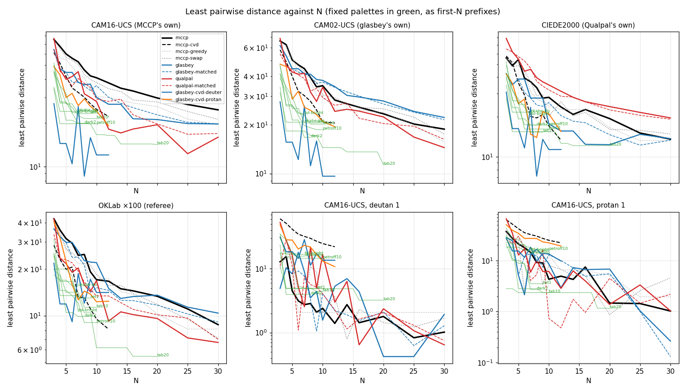

# First prototype: method and comparison

This note reports the first prototype of MCCP and its comparison with
established palettes and palette generators. The design is given in the
README. All results come from `bench/compare.py`, `bench/robustness.py` and
`bench/large_n.py`, run on 2026-11-22.

## 1. What was built

The prototype (package `mccp`) implements Sections 2 and 3 of the README:

- the CAM16-UCS transform with flare, which agrees with colour-science to
  10⁻⁶ over 27 combinations of viewing conditions;
- simulation of deficient colour vision by the matrices of Machado et al.
  (2009);
- anchors, radii, fixed members and the one-sided background lightness
  condition;
- the four-stage method: farthest-point selection with a swap search,
  soft-minimum refinement, polish by sequential linear programming, and
  spreading by the sum of each colour's soft minimum;
- rounding to 8-bit values, followed by a search of single steps that
  restores the constraints and recovers most of the separation lost.

Warm starts from a palette for a nearby N, the matplotlib helpers, and
viewing presets other than "screen" are not yet implemented.

## 2. Protocol

The protocol was fixed before the comparison was run. The background is
white, and N takes 14 values from 3 to 30. Fixed palettes are scored on their
first N entries, as a matplotlib user would meet them. Each palette is scored
by the least pairwise distance in four measures of colour difference. Each
generator optimises one of these, so a win in that column alone proves
nothing:

| Measure | Optimised by |
|---|---|
| CAM16-UCS, "screen" conditions | MCCP |
| CAM02-UCS (colorspacious defaults) | glasbey |
| CIEDE2000 | Qualpal |
| OKLab | none (referee) |

Costs are also reported: the least lightness difference and contrast ratio
against the background, the spread of lightness, the largest chroma, and
departures from MCCP's default conditions.

The generators were run at their defaults and in matched configurations.
Qualpal was given MCCP's admissible candidates and the white background.
glasbey was given lightness bounds of 15 to 75; it has no background
condition, so this match is approximate. For colour-blind palettes, MCCP with
simulated deutan and protan observers was compared with glasbey's
colour-blind-safe mode, which takes one deficiency at a time. Qualpal's
Python interface (qualpal-py 1.1.0) returned identical palettes with and
without its `cvd` option in our tests, and so was not used for this
comparison.

## 3. Results

### 3.1 Normal vision

In its own measure MCCP has the largest least distance at every N. The ratios
to the other generators are as follows.

| MCCP divided by | CAM16-UCS | OKLab (referee) | CAM02-UCS | CIEDE2000 |
|---|---|---|---|---|
| glasbey, defaults | 1.35 (14/14) | 1.02 (7/14) | 0.91 (5/14) | 1.33 (13/14) |
| glasbey, matched | 1.30 (14/14) | 1.14 (13/14) | 0.95 (5/14) | 1.27 (14/14) |
| Qualpal, matched | 1.42 (14/14) | 1.29 (14/14) | 1.15 (13/14) | 0.82 (0/14) |
| MCCP swap search only | 1.06 (14/14) | 1.06 (11/14) | 1.01 (9/14) | 1.01 (9/14) |

Each cell gives the median ratio over the 14 values of N, and in brackets
the number of values of N at which MCCP is ahead.

Each generator wins in its own measure, so the measures disagree. In the
referee measure, MCCP is ahead of the matched configurations at nearly every
N, and level with unconstrained glasbey. glasbey leads in CAM02-UCS for
N ≥ 8, and Qualpal in CIEDE2000 at every N.

The continuous stages add a median of 6 % to the discrete swap search in
MCCP's own measure. Their effect in the other measures is inconsistent.

The fixed palettes lie well below all generators. At N = 10, tab10 has a
least distance of 21.5 against MCCP's 41.0. This is no fault of those
palettes: they were chosen for other qualities, such as moderate chroma,
equal salience and nameable colours.

### 3.2 Sensitivity to viewing conditions

The palettes were scored again under four other sets of CAM16 conditions:
without flare; with Y_b = 20 and an average surround; with the LCD constants;
and in a bright room with 5 % flare. MCCP kept the largest least distance at
13 or 14 of the 14 values of N under the first three sets. Its median margin
over the matched generators was 1.2 to 1.4. In the bright room MCCP won at 9
values of N and its own swap search at 3, and its margin fell to 1.1 to 1.35.
The lead in CAM16-UCS is therefore not an artefact of the particular "screen"
conditions.

### 3.3 Deficient colour vision

The default palettes, designed for normal vision alone, fare badly under
simulated deuteranopia: the closest pair is 2.4 units apart at N = 10,
against 4.4 for tab10 and 14.6 for petroff10.

With deutan and protan observers included, MCCP balances the three
observers. At N = 10 every observer's closest pair is 24.8 to 25.0 units
apart. The worst case over the two simulated observers exceeds glasbey's
colour-blind-safe palettes at all 9 values of N tested. The median ratio is
2.3 against the deutan setting and 1.6 against the protan setting. The cost is
a palette confined to blues, yellows, olives and greys
([figure](img/mccp10_cvd.png)).

### 3.4 Large N

| N | Time (s) | Least distance | Scale before rounding | Scale after rounding |
|---|---|---|---|---|
| 40 | 21 | 21.8 | 10.98 | 10.91 |
| 60 | 37 | 18.3 | 9.23 | 9.14 |
| 80 | 44 | 16.2 | 8.22 | 8.09 |
| 100 | 75 | 14.9 | 7.57 | 7.43 |

Rounding to 8-bit values costs 0.6 to 1.8 % of the scale after the repair
search. Every returned palette satisfies its conditions. Polished starts
differ by about 1 % at large N.

## 4. Limitations

The comparison shows separation under models of colour difference, not
perceptual superiority. No measure has been validated for differences of
the size found between palette colours, and no observer study has been made.

The default palettes reach the boundaries of the sRGB gamut and the
background condition. Their least contrast ratio with white is 1.9, below the
3 to 1 that WCAG 2.1 asks for graphical objects. At N = 7, 8 and 10 they
contain a dark and a bright green, which a reader would call by the same name
([figure](img/mccp10.png); compare [tab10](img/tab10.png)). The colours are
highly saturated. Running time (2 to 20 s for N ≤ 30)
rules out computing palettes interactively without a cache.

## 5. Next steps

In order of cost:

1. Constrain appearance: a chroma ceiling, or distinct colour names (Heer and
   Stone 2012). Measure what each costs in separation.
2. Make the comparisons more robust: several seeds, and glasbey at N = 40 to
   100.
3. Run a small observer study. About 10 to 20 people would match thin lines
   and small markers to legend entries at N = 8 and 16, using palettes from
   MCCP, the matched generators, and tab10 or petroff10. Record errors, time
   and preference. Only such a study can say whether the larger separations
   matter.
