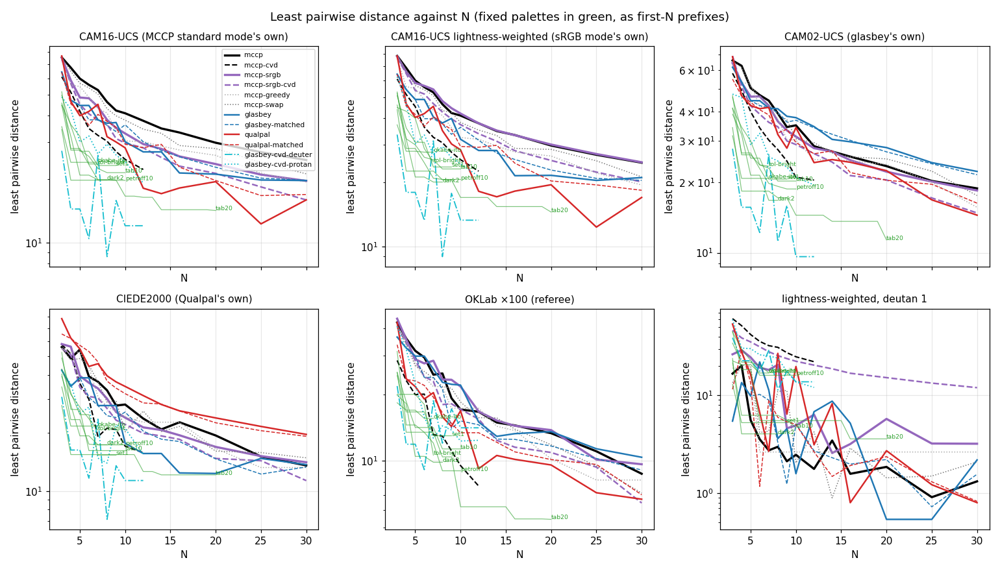
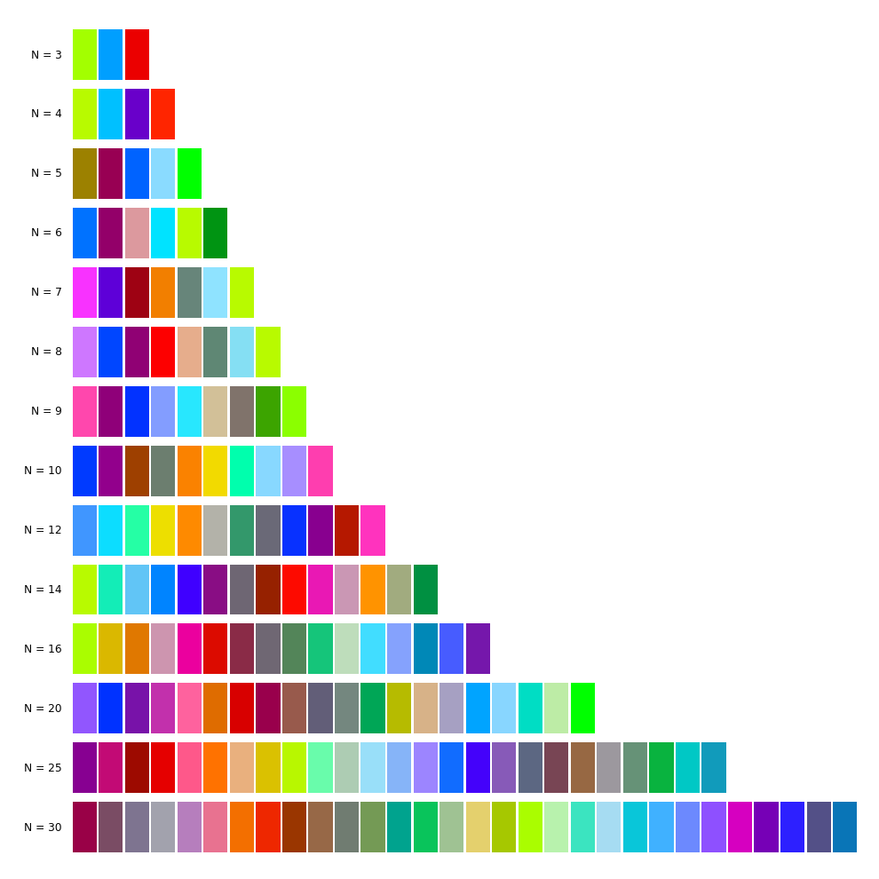
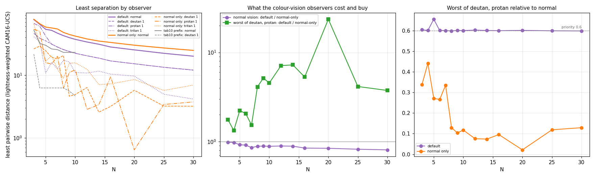

# Results

This note reports comparisons of MCCP with established palettes and palette
generators. Section 3 reports the standard mode (`mode="standard"`:
unweighted CAM16-UCS, one lightness limit, normal vision only). Section 4
reports the default sRGB mode, named for its lightness limits, which follow
the sRGB gamut and were judged on an sRGB display. The formulation is given
in [design.md](design.md).

All results come from the scripts in `bench/`, run on 2026-11-22 on a
desktop with an Intel Core i7-13700K, with glasbey 0.4.0, qualpal-py 1.1.0,
colour-science 0.4.7 and colorspacious 1.1.2. Times are single runs and are
indicative only. The data behind every table are in [data/](data/).

## 1. The two modes

Both modes use the same colour-appearance transform, the same simulation of
colour vision and the same optimisation method ([design.md](design.md)).
They differ in three respects:

| | Standard mode | sRGB mode (default) |
|---|---|---|
| Lightness weight $K_L$ | 1 | 0.77 |
| Lightness limits | one limit from the background, $\Delta J'_b = 25$ | limits by hue, measured by eye ([calibration.md](calibration.md)) |
| Simulated observers | none unless requested | deutan and protan guaranteed 0.6 of the normal-vision separation, tritan 0.2 |

## 2. Protocol

The protocol (`bench/compare.py`) was fixed before the first comparison
(Section 3). The sRGB mode was developed afterwards and scored with the same
protocol. The background is
white, and N takes 14 values from 3 to 30. Fixed palettes are scored on their
first N entries, as a matplotlib user would meet them. Each palette is scored
by the least pairwise distance in four measures of colour difference. Each
generator optimises one of these, so a win in that column alone proves
nothing:

| Measure | Optimised by |
|---|---|
| CAM16-UCS, under the `screen` viewing preset ([design.md](design.md), Section 2) | MCCP, standard mode |
| CAM16-UCS with lightness weight $K_L = 0.77$ | MCCP, sRGB mode |
| CAM02-UCS, as computed by the colorspacious package with its default viewing conditions | glasbey |
| CIEDE2000 | Qualpal |
| OKLab | none (referee) |

Costs are also reported: the least lightness difference and contrast ratio
against the background, the spread of lightness, the largest chroma, and
departures from the standard mode's conditions (a lightness difference from
white of at least 25, and a distance of at least 15 from black).

The generators were run at their defaults and in matched configurations,
matched to the standard mode. Qualpal was given the standard mode's
admissible candidates on a grid of 16³ colours, and the white background.
glasbey was given bounds of 15 to 75 on its lightness J in CAM02-UCS. It has
no background condition, so this match is approximate. For colour-blind palettes, MCCP with
simulated deutan and protan observers was compared with glasbey's
colour-blind-safe mode, which takes one deficiency at a time, with the same
lightness bounds and full severity. Qualpal's
Python interface (qualpal-py 1.1.0) returned identical palettes with and
without its `cvd` option in our tests, and so was not used for this
comparison.

## 3. The standard mode

### 3.1 Normal vision

In its own measure the standard mode has the largest least distance at 13
of the 14 values of N; Qualpal's default is 1.6 % ahead at N = 3. The ratios
to the other generators are as follows.

| Standard mode divided by | CAM16-UCS | OKLab (referee) | CAM02-UCS | CIEDE2000 |
|---|---|---|---|---|
| glasbey, defaults | 1.35 (14/14) | 1.02 (7/14) | 0.91 (5/14) | 1.33 (13/14) |
| glasbey, matched | 1.30 (14/14) | 1.14 (13/14) | 0.95 (5/14) | 1.27 (14/14) |
| Qualpal, defaults | 1.48 (13/14) | 1.42 (14/14) | 1.16 (13/14) | 0.80 (0/14) |
| Qualpal, matched | 1.42 (14/14) | 1.29 (14/14) | 1.15 (13/14) | 0.82 (0/14) |
| MCCP stopped after its first stage | 1.06 (14/14) | 1.06 (11/14) | 1.01 (9/14) | 1.01 (9/14) |

Each cell gives the median ratio over the 14 values of N, and in brackets
the number of values of N at which MCCP is ahead. The last row compares the
full method with its first stage alone (farthest-point selection and swap
search, [design.md](design.md), Section 6).

Each generator wins in its own measure, so the measures disagree. In the
referee measure, MCCP is ahead of the matched configurations at nearly every
N, and level with unconstrained glasbey. glasbey leads in CAM02-UCS for
N ≥ 8, and Qualpal in CIEDE2000 at every N.

The later, continuous stages add a median of 6 % to the first stage in
MCCP's own measure. Their effect in the other measures is inconsistent.

The fixed palettes lie well below all generators. At N = 10, tab10 has a
least distance of 21.5 against MCCP's 41.0. This is no fault of those
palettes: they were chosen for other qualities, such as moderate chroma,
equal salience and nameable colours.

### 3.2 Sensitivity to viewing conditions

The standard-mode palettes were scored again under four other sets of CAM16
conditions: without flare; with $Y_b = 20$ and an average surround; with the
constants of Luo et al. (2006) for large differences
([cam16-reference.md](cam16-reference.md)); and in a bright room with 5 %
flare. MCCP kept the largest least distance at 13 or 14 of the 14 values of N
under the first three sets. Its median margin over the matched generators was
1.2 to 1.4. In the bright room MCCP won at 9 values of N, its own first stage
at 3, and glasbey (once at defaults, once matched) at the other 2, and its margin fell to 1.1 to 1.35. The lead
in CAM16-UCS is therefore not an artefact of the particular viewing
conditions. This check was made for the standard mode only.

### 3.3 Deficient colour vision

Standard-mode palettes, designed for normal vision alone, fare badly under
simulated deuteranopia: the closest pair is 2.4 units apart at N = 10,
against 4.4 for tab10 and 14.6 for matplotlib's petroff10 (Petroff 2021).

With deutan and protan observers at full priority (each guaranteed the whole
normal-vision separation), MCCP balances the three observers. At N = 10 every
observer's closest pair is 24.8 to 25.0 units apart, while the tritan
observer, not included, has 5.7. The worst case over the two simulated observers exceeds glasbey's
colour-blind-safe palettes at all 9 values of N tested. The median ratio is
2.3 against the deutan setting and 1.6 against the protan setting. The cost is
a palette confined to blues, yellows, olives and greys
([figure](img/mccp10_cvd.png)).

### 3.4 Large N

These runs used the standard mode with four starting sets instead of eight.
The scale is s, half the least distance ([design.md](design.md),
Section 5).

| N | Time (s) | Least distance | Scale before rounding | Scale after rounding |
|---|---|---|---|---|
| 40 | 21 | 21.8 | 10.98 | 10.91 |
| 60 | 37 | 18.3 | 9.23 | 9.14 |
| 80 | 44 | 16.2 | 8.22 | 8.09 |
| 100 | 75 | 14.9 | 7.57 | 7.43 |

Rounding to 8-bit values costs 0.6 to 1.8 % of the scale after the repair
search. Every returned palette satisfies its conditions. Polished starts
differ by about 1 % at large N.

## 4. The sRGB mode

The sRGB mode differs from the standard mode in its lightness weight
([design.md](design.md), Section 2), its lightness limits by hue
([calibration.md](calibration.md)) and its simulated observers. The author
chose the weight $K_L = 0.77$ after comparing ring figures
([test-figures.md](test-figures.md)) drawn with it, with the unweighted
space, and with the constants of Luo et al. (2006) for large differences.

In the lightness-weighted measure, the observers cost normal vision 1 % of
its least separation at N = 3, about 11 % at N = 10, and 19 % at N = 30. In
return the worst of the deutan and protan separations stays at 0.6 of the
normal one for every N. Palettes for normal vision alone (`observers=[]`)
fall to between 0.02 and 0.13 of it for N of 8 and above. The author
preferred the default palettes to those for normal vision alone
([figure](img/mccp10_srgb_cvd.png)).

The default palettes compared with the other programs, N from 3 to 30
(median ratio over N, and the number of values of N at which MCCP is
ahead):

| Default MCCP divided by | Own measure (lightness-weighted) | OKLab | CAM02-UCS | CIEDE2000 | Deutan, severity 1 (lightness-weighted) |
|---|---|---|---|---|---|
| glasbey | 1.14 (12/14) | 0.85 (3/14) | 0.79 (1/14) | 1.15 (8/14) | 4.4 (14/14) |
| glasbey, matched | 1.12 (13/14) | 0.97 (6/14) | 0.81 (1/14) | 1.02 (9/14) | 7.6 (14/14) |
| Qualpal | 1.31 (13/14) | 1.16 (12/14) | 1.00 (7/14) | 0.66 (0/14) | 4.2 (12/14) |
| Qualpal, matched | 1.15 (14/14) | 1.13 (12/14) | 0.97 (5/14) | 0.69 (0/14) | 5.4 (14/14) |
| glasbey, colour-blind safe (protan) | 1.53 (9/9) | 1.27 (9/9) | 1.38 (9/9) | 1.30 (9/9) | 1.2 (8/9) |

glasbey and Qualpal design for normal vision alone. Against them, the default
gives up some separation in the measures they optimise, and gains a factor
of four to eight for deuteranopes (median over N). Qualpal's default is
ahead for deuteranopes at 2 of the 14 values of N. The "matched"
configurations were matched to the standard mode, not to the sRGB mode.
Against glasbey's colour-blind-safe mode, which guards one deficiency at a
time (N up to 12), the default is ahead in nearly every measure.

Part of the lead in the sRGB mode's own measure is built in: its lightness
weight was chosen by the same observer who judged the palettes.

These results rest on the judgements of one observer on one display. The
lightness limits are calibrated on white, black and #333333, and
interpolated for other backgrounds.

## 5. Limitations

The comparisons show separation under models of colour difference, not
perceptual superiority. No measure has been validated for differences of
the size found between palette colours, and no study of readers has been
made.

In the standard mode, palettes reach the boundaries of the sRGB gamut and of
the background condition. At N = 7, 8 and 10 they contain a dark and a bright
green, which a reader would call by the same name
([figure](img/mccp10.png); compare [tab10](img/tab10.png)). The sRGB mode
removed these faults in the author's judgement, but admits colours of low
luminance contrast with the background: on white, a least contrast ratio of
1.25 to 1.37 at every N tested, against 2.0 to 2.5 for tab10.

Computing a palette in the default mode takes from a few seconds at small N
to one or two minutes at N = 50. Palettes with default settings are
therefore precomputed for N from 1 to 50 on the calibrated backgrounds.

## 6. Next steps

In order of cost:

1. Calibration of a mid-grey background, with charts that find both edges
   of the band around the background.
2. Repetition of the calibration with other observers and displays.
3. Tests of distinct colour names (Heer and Stone 2012) as part of the
   measure of difference, and of ellipsoidal radii for different kinds of
   mark (Szafir 2018).
4. A small study of readers. About 10 to 20 people would match thin lines
   and small markers to legend entries at N = 8 and 16, using palettes from
   MCCP, glasbey, Qualpal and tab10, with errors, time and preference
   recorded. Only such a study can show whether the larger separations
   matter.

## References

- Heer, J., and Stone, M. (2012). Color naming models for color selection,
  image editing and palette design. Proc. CHI 2012.
- Luo, M. R., Cui, G., and Li, C. (2006). Uniform colour spaces based on
  CIECAM02 colour appearance model. Color Research and Application 31(4),
  320–330.
- Petroff, M. A. (2021). Accessible color sequences for data visualization.
  arXiv:2107.02270.
- Szafir, D. A. (2018). Modeling color difference for visualization design.
  IEEE Transactions on Visualization and Computer Graphics 24(1), 392–401.
